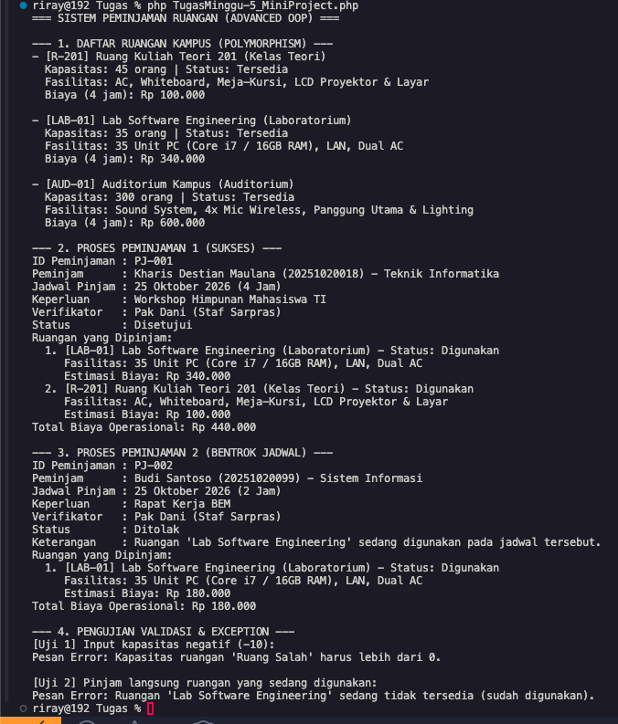

# Mini Project: Sistem Peminjaman Ruangan (Advanced OOP)

Tugas Praktikum Minggu 5 - Pemrograman Berorientasi Objek (TI033015)  
Program Studi S1 Teknik Informatika, Universitas Catur Insan Cendekia (UCIC)

* Nama: Kharis Destian Maulana
* NIM: 20251020018
* Dosen Pengampu: Hilman Lesmana, S.T., M.S.F.

---

## Overview

Proyek ini adalah lanjutan dari studi kasus sistem peminjaman ruangan kampus yang sudah saya buat sejak Minggu 1 sampai Minggu 4. 

Di tugas Minggu 5 ini, kodenya di-refactor ke konsep Advanced OOP agar strukturnya lebih modular, gampang di-scale, dan aman dari modifikasi langsung. Fokus utama tugas ini adalah menerapkan:
* Interface sebagai kontrak kapabilitas
* Abstract class sebagai blueprint umum
* Inheritance dan method overriding
* Polymorphism tanpa percabangan if/else manual
* Composition untuk relasi antar objek
* Enkapsulasi data dan validasi exception

---

## Rancangan Objek dan Konsep OOP

### 1. Interface (BisaDipinjam)
Berfungsi sebagai kontrak kapabilitas (can-do). Interface ini memastikan semua jenis ruangan atau fasilitas kampus yang mau dipinjam wajib punya method standar berikut:
* `pinjam(string $peminjam, string $keperluan): void`
* `kembalikan(): void`
* `isTersedia(): bool`
* `getNamaRuangan(): string`

### 2. Abstract Class (Ruangan)
Class `Ruangan` menjadi kelas induk (parent) abstrak yang mengimplementasikan interface `BisaDipinjam`. Semua atribut dasar seperti `$kodeRuangan`, `$namaRuangan`, `$kapasitas`, dan `$status` dipusatkan di sini dengan visibilitas protected/private.

Class ini juga mewajibkan anak-anaknya mengimplementasikan tiga method abstract:
* `getTipeRuangan(): string`
* `getFasilitasKhusus(): string`
* `hitungBiayaOperasional(int $durasiJam): float`

### 3. Inheritance dan Overriding
Saya membagi ruangan menjadi 3 subclass sesuai kondisi nyata di kampus:
* **RuanganTeori**: Ruang kelas kuliah biasa. Meng-override method fasilitas (AC, whiteboard, proyektor) dan punya biaya operasional dasar (Rp 25.000 / jam).
* **RuanganLaboratorium**: Ruang lab komputer. Punya atribut tambahan jumlah PC dan spesifikasi. Biaya operasionalnya lebih tinggi (Rp 80.000 / jam + biaya maintenance lab) karena konsumsi daya komputer dan jaringan.
* **RuanganAuditorium**: Aula kapasitas besar (300 orang). Meng-override fasilitas untuk kebutuhan panggung dan sound system, dengan tarif Rp 150.000 / jam.

### 4. Composition (Peminjaman has-a Ruangan & Mahasiswa)
Daripada memaksakan inheritance untuk transaksi, saya menggunakan teknik composition:
* Class `Peminjaman` mengantongi objek `Mahasiswa` (pengaju).
* Class `Peminjaman` mengantongi array dari objek `Ruangan` yang diajukan.
* Ada integrasi objek `Petugas` untuk proses verifikasi status (disetujui atau ditolak).

### 5. Polymorphism
Diimplementasikan lewat fungsi independen:
```php
function tampilkanKatalog(Ruangan $ruangan, int $durasiJam): void
```
Fungsi ini cuma menerima tipe parent `Ruangan`. Waktu fungsi ini memanggil method `getFasilitasKhusus()` atau `hitungBiayaOperasional()`, PHP otomatis memanggil implementasi milik class anaknya masing-masing saat runtime. Jadi fungsi pemanggil tidak perlu tahu detail tipe konkretnya dan bebas dari percabangan `if/else`.

### 6. Validasi dan Exception
Melanjutkan enkapsulasi dari Minggu 4:
* Constructor menolak kapasitas bernilai nol atau minus (`InvalidArgumentException`).
* Sistem menolak peminjaman jika ruangan yang diajukan statusnya sedang dipakai atau bentrok (`RuntimeException`).

---

## Cara Menjalankan Kode

Pastikan PHP versi 8 ke atas sudah aktif di terminal. Cukup jalankan perintah berikut dari root folder repo:

```bash
php TugasMinggu-5_MiniProject.php
```

---

## Hasil Eksekusi Program

Berikut output saat kode dijalankan di terminal:

```text
=== SISTEM PEMINJAMAN RUANGAN (ADVANCED OOP) ===

--- 1. DAFTAR RUANGAN KAMPUS (POLYMORPHISM) ---
- [R-201] Ruang Kuliah Teori 201 (Kelas Teori)
  Kapasitas: 45 orang | Status: Tersedia
  Fasilitas: AC, Whiteboard, Meja-Kursi, LCD Proyektor & Layar
  Biaya (4 jam): Rp 100.000

- [LAB-01] Lab Software Engineering (Laboratorium)
  Kapasitas: 35 orang | Status: Tersedia
  Fasilitas: 35 Unit PC (Core i7 / 16GB RAM), LAN, Dual AC
  Biaya (4 jam): Rp 340.000

- [AUD-01] Auditorium Kampus (Auditorium)
  Kapasitas: 300 orang | Status: Tersedia
  Fasilitas: Sound System, 4x Mic Wireless, Panggung Utama & Lighting
  Biaya (4 jam): Rp 600.000

--- 2. PROSES PEMINJAMAN 1 (SUKSES) ---
ID Peminjaman : PJ-001
Peminjam      : Kharis Destian Maulana (20251020018) - Teknik Informatika
Jadwal Pinjam : 25 Oktober 2026 (4 Jam)
Keperluan     : Workshop Himpunan Mahasiswa TI
Verifikator   : Pak Dani (Staf Sarpras)
Status        : Disetujui
Ruangan yang Dipinjam:
  1. [LAB-01] Lab Software Engineering (Laboratorium) - Status: Digunakan
     Fasilitas: 35 Unit PC (Core i7 / 16GB RAM), LAN, Dual AC
     Estimasi Biaya: Rp 340.000
  2. [R-201] Ruang Kuliah Teori 201 (Kelas Teori) - Status: Digunakan
     Fasilitas: AC, Whiteboard, Meja-Kursi, LCD Proyektor & Layar
     Estimasi Biaya: Rp 100.000
Total Biaya Operasional: Rp 440.000

--- 3. PROSES PEMINJAMAN 2 (BENTROK JADWAL) ---
ID Peminjaman : PJ-002
Peminjam      : Budi Santoso (20251020099) - Sistem Informasi
Jadwal Pinjam : 25 Oktober 2026 (2 Jam)
Keperluan     : Rapat Kerja BEM
Verifikator   : Pak Dani (Staf Sarpras)
Status        : Ditolak
Keterangan    : Ruangan 'Lab Software Engineering' sedang digunakan pada jadwal tersebut.
Ruangan yang Dipinjam:
  1. [LAB-01] Lab Software Engineering (Laboratorium) - Status: Digunakan
     Fasilitas: 35 Unit PC (Core i7 / 16GB RAM), LAN, Dual AC
     Estimasi Biaya: Rp 180.000
Total Biaya Operasional: Rp 180.000

--- 4. PENGUJIAN VALIDASI & EXCEPTION ---
[Uji 1] Input kapasitas negatif (-10):
Pesan Error: Kapasitas ruangan 'Ruang Salah' harus lebih dari 0.

[Uji 2] Pinjam langsung ruangan yang sedang digunakan:
Pesan Error: Ruangan 'Lab Software Engineering' sedang tidak tersedia (sudah digunakan).
```

### Screenshot Terminal



---

## Refleksi Desain

Perbedaan paling terasa dibanding tugas Minggu 3 dan 4 adalah fleksibilitas arsitekturnya. Waktu di awal, class `Ruangan` masih berdiri sendiri dan serba kaku. Sekarang dengan adanya `abstract class`, `interface`, dan `composition`:
1. Sistem gampang dikembangkan lagi kalau sewaktu-waktu kampus nambah fasilitas baru (misal ruang studio podcast atau ruang rapat VIP), tinggal buat subclass baru tanpa perlu ngutak-atik kode transaksi peminjaman yang sudah berjalan.
2. Relasi `has-a` pada `Peminjaman` bikin pengelolaan transaksi multi-ruangan jadi jauh lebih rapi dibanding memaksakan hubungan turunan (*inheritance*).
